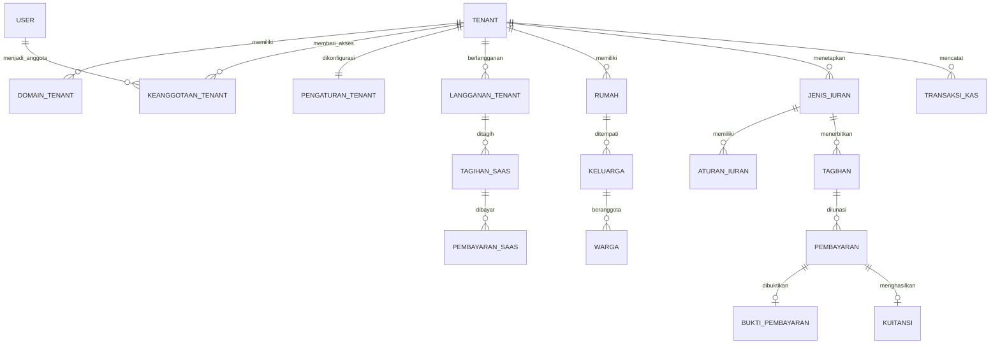

# ERD Terverifikasi — Ekosistem Warga

## Status, Dasar Rancangan, dan Batasan

- Status: **rancangan data V1 hasil audit kode**, belum migration dan belum database Supabase.
- Sumber fakta: `prisma/schema.prisma`, server action di `lib/cms`, form input, serta route yang sudah ada di repository.
- Sumber keputusan bisnis: diskusi produk pada 26–27 Oktober 2026.
- Konvensi: tabel dan kolom bisnis memakai Bahasa Indonesia `snake_case`; model Prisma boleh tetap PascalCase seperti `Rumah` dan `Tagihan`.
- Pengecualian: tabel Better Auth tetap `user`, `session`, `account`, `verification`, dan `rate_limit` agar sesuai kontrak library.
- Database produksi: satu PostgreSQL/Supabase. Ini bukan 41 database terpisah.
- Total rancangan V1: **41 tabel**, tetapi dibangun lewat tiga migration bertahap—bukan sekaligus.

## Label Asal Field

| Label | Arti |
| --- | --- |
| `[K]` | Sudah ada dan dipakai oleh kode saat ini. |
| `[B]` | Keputusan bisnis yang sudah disepakati. |
| `[T]` | Tambahan teknis/integritas yang diperlukan untuk SaaS dan keamanan. |

## Klasifikasi Fungsi Data

Bagian ini menjelaskan fungsi bisnis tabel, **bukan** nama schema PostgreSQL fisik. Nama schema fisik ditetapkan pada bagian berikutnya agar tabel tidak tercampur saat database tumbuh.

| Klasifikasi | Ciri | Tabel |
| --- | --- | --- |
| **Master** | Data utama yang dipakai berulang dan relatif stabil. Tidak boleh dihapus sembarangan setelah dipakai transaksi. | `tenant`, `keanggotaan_tenant`, `rumah`, `keluarga`, `warga`, `jenis_iuran`, `aturan_iuran`, `kanal_pembayaran_tenant`, `kategori_kas`, `jenis_surat`, `pengurus_situs` |
| **Referensi / konfigurasi** | Data pengarah sistem atau pilihan konfigurasi; bukan catatan kejadian bisnis. | `domain_tenant`, `pengaturan_tenant`, `aset_media`, `urutan`, `pengaturan_situs` |
| **Transaksi / operasional** | Catatan kejadian yang memiliki waktu, status, pelaku, atau bukti. Riwayatnya dipertahankan. | `langganan_tenant`, `tagihan_saas`, `pembayaran_saas`, `tagihan`, `pembayaran`, `bukti_pembayaran`, `kuitansi`, `transaksi_kas`, `pengajuan_surat`, `lampiran`, `pengumuman`, `pengumuman_dibaca`, `pengaduan`, `pembaruan_pengaduan`, `kegiatan`, `peserta_kegiatan`, `notifikasi`, `foto_galeri`, `artikel_situs` |
| **Teknis / keamanan** | Kontrak autentikasi, pembatasan request, serta jejak keamanan; bukan master maupun transaksi bisnis RT. | `user`, `session`, `account`, `verification`, `rate_limit`, `audit_log` |

**Catatan referensi status:** nilai kecil dan tertutup seperti status tagihan, metode bayar, status pengaduan, dan frekuensi iuran memakai enum/check constraint; tidak dibuat tabel `master_status` terpisah karena justru menambah redundansi tanpa kebutuhan bisnis saat ini.

## Schema PostgreSQL Fisik (Supabase)

Satu database Supabase tetap dipakai bersama oleh semua RT. Schema PostgreSQL dipakai untuk **mengelompokkan domain tabel**, sedangkan `tenant_id` tetap menjadi pembatas wajib untuk data milik RT. Schema bukan pengganti `tenant_id` dan bukan berarti satu RT mendapat schema/database sendiri.

| Schema | Fungsi | Tabel fisik |
| --- | --- | --- |
| `platform` | Data pusat SaaS Ekosistem Warga: identitas pelanggan RT, domain portal, akses admin, dan penagihan aplikasi. | `platform.tenant`, `platform.domain_tenant`, `platform.keanggotaan_tenant`, `platform.langganan_tenant`, `platform.tagihan_saas`, `platform.pembayaran_saas` |
| `master` | Data inti RT yang dipakai berulang untuk operasional. | `master.rumah`, `master.keluarga`, `master.warga`, `master.jenis_iuran`, `master.kategori_kas`, `master.jenis_surat` |
| `ref` | Pengaturan dan referensi yang mengarahkan perilaku tenant, bukan kejadian transaksi. | `ref.pengaturan_tenant`, `ref.aturan_iuran`, `ref.aset_media`, `ref.kanal_pembayaran_tenant`, `ref.urutan`, `ref.pengaturan_situs` |
| `trx` | Catatan kejadian bisnis yang memiliki tanggal, nominal, status, pelaku, atau bukti; riwayatnya dipertahankan. | `trx.tagihan`, `trx.pembayaran`, `trx.bukti_pembayaran`, `trx.kuitansi`, `trx.transaksi_kas`, `trx.pengajuan_surat`, `trx.lampiran`, `trx.pengaduan`, `trx.pembaruan_pengaduan` |
| `portal` | Konten dan interaksi yang tampil pada portal warga masing-masing RT. | `portal.pengumuman`, `portal.pengumuman_dibaca`, `portal.kegiatan`, `portal.peserta_kegiatan`, `portal.notifikasi`, `portal.foto_galeri`, `portal.artikel_situs`, `portal.pengurus_situs` |
| `identity` | Kontrak akun dan sesi Better Auth milik aplikasi. | `identity.user`, `identity.session`, `identity.account`, `identity.verification`, `identity.rate_limit` |
| `audit` | Jejak perubahan dan keamanan yang tidak boleh bercampur dengan transaksi bisnis. | `audit.audit_log` |

**Aturan penting Supabase:** schema `auth` adalah schema internal Supabase Auth, sehingga tabel Better Auth aplikasi **tidak** boleh ditempatkan pada `auth`. Nama `identity` dipakai agar tidak berbenturan. Implementasi Prisma harus lebih dahulu divalidasi untuk dukungan multi-schema dan adapter Better Auth; sampai validasi itu selesai, nama tabel Better Auth tidak boleh diubah.

**Aturan akses:** schema yang perlu diakses dari browser/Supabase API harus didaftarkan secara eksplisit sebagai exposed schema dan tetap dilindungi RLS. Akses server melalui Prisma memakai koneksi database langsung, tetapi semua query data RT tetap wajib memfilter `tenant_id`.

## Konvensi Nama Primary Key

- Semua tabel bisnis memakai primary key bernama sesuai entitas: `tenant_id`, `rumah_id`, `tagihan_id`, dan seterusnya—bukan `id` generik.
- Foreign key memakai nama primary key tabel yang dirujuk, misalnya `keluarga_id` pada `warga`, atau `tagihan_id` pada `pembayaran`.
- Pengecualian hanya tabel Better Auth: `user.id`, `session.id`, `account.id`, dan `verification.id` tetap mengikuti kontrak library.

## Prinsip yang Tidak Boleh Dilanggar

1. Semua tabel operasional RT wajib mempunyai `tenant_id`, kecuali lima tabel Better Auth.
2. Query aplikasi wajib membawa konteks `tenant_id`; RLS Supabase nanti menjadi lapisan tambahan, bukan satu-satunya pengaman.
3. Satu rumah boleh memiliki beberapa keluarga aktif. Jenis iuran menentukan sasaran tagihan: `RUMAH` atau `KELUARGA`.
4. V1 tidak mendukung cicilan: satu `pembayaran` melunasi satu `tagihan` secara penuh.
5. Pembayaran iuran warga masuk ke rekening/QRIS RT. Pembayaran SaaS masuk ke Ekosistem Warga. Keduanya tidak boleh bercampur di `transaksi_kas` RT.
6. File tidak disimpan sebagai `Bytes` di PostgreSQL produksi; metadata ada di `aset_media`, berkasnya berada di Supabase Storage.
7. Data transaksi dan audit tidak dihapus fisik setelah tervalidasi; koreksi dilakukan lewat status atau transaksi pembalik.

## Tahapan Migration

| Tahap | Tujuan | Tabel | Kondisi selesai |
| --- | --- | --- | --- |
| 1 — Fondasi SaaS | Membuat RT sebagai tenant dan memberi akses per RT | 12 tabel | Subdomain dapat diresolusikan, admin RT memiliki membership, data single-RT punya tenant awal. |
| 2 — Operasional inti | Menjalankan warga, iuran, kas, QRIS/transfer/cash manual | 14 tabel | Tagihan per rumah/keluarga dan pembayaran manual berjalan pada tenant terisolasi. |
| 3 — Administrasi & portal | Surat, komunikasi, kegiatan, konten portal | 15 tabel | Modul tambahan siap ditenant-kan tanpa data silang. |

## ERD Ringkas

## Tahap 1 — Fondasi SaaS dan Akses

### 1. `tenant`
**Fungsi:** satu pelanggan RT dan akar isolasi seluruh data.

| Kolom | Tipe | Asal | Fungsi |
| --- | --- | --- | --- |
| `tenant_id` | `uuid` PK | `[T]` | ID tenant yang dirujuk semua data RT. |
| `slug` | `text` UQ | `[B]` | Identitas URL global, contoh `rt04-rw02`. |
| `nama` | `text` | `[B]` | Nama tampilan pelanggan/RT. |
| `nomor_rt` | `text` | `[B]` | Nomor RT administratif. |
| `nomor_rw` | `text` nullable | `[B]` | Nomor RW bila ada. |
| `status` | `text` | `[B]` | `DRAF`, `AKTIF`, `BACA_SAJA`, `NONAKTIF`. |
| `zona_waktu` | `text` | `[T]` | Zona waktu tenant untuk jadwal/tagihan. |
| `dibuat_pada` | `timestamptz` | `[T]` | Waktu tenant dibuat. |
| `diubah_pada` | `timestamptz` | `[T]` | Waktu tenant diperbarui. |

Constraint/index: `UNIQUE(slug)`, `INDEX(status)`.

### 2. `domain_tenant`
**Fungsi:** registry subdomain/domain yang mengarah ke tenant; DNS dan SSL dikelola infrastruktur, bukan disimpan di tabel ini.

| Kolom | Tipe | Asal | Fungsi |
| --- | --- | --- | --- |
| `domain_tenant_id` | `uuid` PK | `[T]` | ID mapping domain. |
| `tenant_id` | `uuid` FK | `[B]` | Tenant pemilik domain. |
| `hostname` | `text` UQ | `[B]` | Contoh `rt04rw02.ekosistemwarga.id`. |
| `jenis` | `text` | `[T]` | `SUBDOMAIN_PLATFORM` atau `DOMAIN_KUSTOM`. |
| `utama` | `boolean` | `[T]` | Menandai hostname utama tenant. |
| `terverifikasi_pada` | `timestamptz` nullable | `[T]` | Waktu domain kustom lolos verifikasi. |
| `dibuat_pada` | `timestamptz` | `[T]` | Waktu mapping dibuat. |

Constraint/index: `UNIQUE(hostname)`, satu domain `utama=true` per tenant, `INDEX(tenant_id)`.

### 3. `keanggotaan_tenant`
**Fungsi:** hak akses user pada RT tertentu; inilah sumber role RT, bukan `user.role` global.

| Kolom | Tipe | Asal | Fungsi |
| --- | --- | --- | --- |
| `keanggotaan_tenant_id` | `uuid` PK | `[T]` | ID membership. |
| `tenant_id` | `uuid` FK | `[B]` | RT tempat user menjadi anggota. |
| `user_id` | `text` FK → `user.id` | `[B]` | Akun yang diberi akses. |
| `warga_id` | `uuid` FK nullable | `[T]` | Link ke data warga bila akun ini milik warga tenant tersebut. |
| `peran` | `text` | `[B]` | `ADMIN_RT`, `KETUA_RT`, `BENDAHARA`, `SEKRETARIS`, `PENGURUS`, `WARGA`. |
| `status` | `text` | `[T]` | `DIUNDANG`, `AKTIF`, `DITANGGUHKAN`, `DICABUT`. |
| `aktif_pada` | `timestamptz` nullable | `[T]` | Waktu undangan diaktifkan. |
| `dibuat_pada` | `timestamptz` | `[T]` | Waktu membership dibuat. |
| `diubah_pada` | `timestamptz` | `[T]` | Waktu membership berubah. |

Constraint/index: `UNIQUE(tenant_id, user_id)`, unique `warga_id` per tenant bila terisi, `INDEX(tenant_id, peran, status)`, `INDEX(user_id, status)`.

### 4. `pengaturan_tenant`
**Fungsi:** menggantikan singleton `pengaturan_rt`; identitas RT dan konfigurasi dasar portal.

| Kolom | Tipe | Asal | Fungsi |
| --- | --- | --- | --- |
| `tenant_id` | `uuid` PK/FK | `[B]` | Satu pengaturan untuk satu tenant. |
| `nama_rt` | `text` | `[K]` | Nama resmi RT pada portal/dokumen. |
| `alamat` | `text` nullable | `[K]` | Alamat sekretariat/lingkungan. |
| `kontak` | `text` nullable | `[K]` | Kontak publik RT. |
| `diubah_pada` | `timestamptz` | `[K]` | Waktu pengaturan terakhir berubah. |

Catatan: rekening dan QRIS tidak ditaruh di sini karena satu tenant dapat menyediakan lebih dari satu kanal pembayaran; gunakan tabel 19.

### 5. `langganan_tenant`
**Fungsi:** masa layanan SaaS per RT, termasuk masa tenggang dan status read-only.

| Kolom | Tipe | Asal | Fungsi |
| --- | --- | --- | --- |
| `langganan_tenant_id` | `uuid` PK | `[B]` | ID periode langganan. |
| `tenant_id` | `uuid` FK | `[B]` | Tenant pelanggan. |
| `kode_paket` | `text` | `[B]` | Awal: `FOUNDER_RT`. |
| `batas_kk` | `integer` | `[B]` | Awal: maksimal 100 KK. |
| `harga` | `numeric(14,2)` | `[B]` | Snapshot harga periode, awal Rp299.000. |
| `mulai_pada` | `date` | `[B]` | Awal layanan. |
| `berakhir_pada` | `date` | `[B]` | Akhir masa 6 bulan. |
| `tenggang_berakhir_pada` | `date` | `[B]` | Akhir grace period 14 hari. |
| `status` | `text` | `[B]` | `COBA`, `AKTIF`, `TENGGANG`, `BACA_SAJA`, `BERAKHIR`. |
| `dibuat_pada` | `timestamptz` | `[T]` | Waktu dibuat. |
| `diubah_pada` | `timestamptz` | `[T]` | Waktu diubah. |

Index: `INDEX(tenant_id, status, berakhir_pada DESC)`.

### 6. `tagihan_saas`
**Fungsi:** tagihan Ekosistem Warga kepada RT; tidak pernah menjadi kas tenant.

| Kolom | Tipe | Asal | Fungsi |
| --- | --- | --- | --- |
| `tagihan_saas_id` | `uuid` PK | `[B]` | ID tagihan SaaS. |
| `tenant_id` | `uuid` FK | `[B]` | RT yang ditagih. |
| `langganan_tenant_id` | `uuid` FK | `[B]` | Periode langganan yang dibayar. |
| `nomor` | `text` UQ | `[T]` | Nomor tagihan SaaS. |
| `periode_mulai` | `date` | `[B]` | Awal periode layanan. |
| `periode_akhir` | `date` | `[B]` | Akhir periode layanan. |
| `nominal` | `numeric(14,2)` | `[B]` | Nominal yang ditagihkan. |
| `jatuh_tempo` | `date` | `[B]` | Jatuh tempo pembayaran. |
| `status` | `text` | `[B]` | `DRAF`, `TERBIT`, `LUNAS`, `BATAL`, `LEWAT_JATUH_TEMPO`. |
| `diterbitkan_pada` | `timestamptz` nullable | `[T]` | Waktu tagihan diterbitkan. |
| `lunas_pada` | `timestamptz` nullable | `[T]` | Waktu dinyatakan lunas. |
| `dibuat_pada` | `timestamptz` | `[T]` | Waktu dibuat. |

Constraint/index: `UNIQUE(nomor)`, `INDEX(tenant_id, status, jatuh_tempo)`.

### 7. `pembayaran_saas`
**Fungsi:** bukti dan verifikasi pembayaran SaaS oleh RT ke Ekosistem Warga.

| Kolom | Tipe | Asal | Fungsi |
| --- | --- | --- | --- |
| `pembayaran_saas_id` | `uuid` PK | `[B]` | ID pembayaran SaaS. |
| `tagihan_saas_id` | `uuid` FK | `[B]` | Tagihan SaaS yang dibayar. |
| `tenant_id` | `uuid` FK | `[B]` | Tenant pembayar untuk query cepat. |
| `metode` | `text` | `[B]` | `QRIS`, `TRANSFER`, atau `TUNAI`. |
| `nominal` | `numeric(14,2)` | `[B]` | Nominal diterima. |
| `tanggal_bayar` | `date` | `[B]` | Tanggal pembayaran. |
| `status` | `text` | `[T]` | `MENUNGGU_VERIFIKASI`, `TERVERIFIKASI`, `DITOLAK`. |
| `bukti_media_id` | `uuid` FK nullable | `[T]` | Bukti transfer/QRIS pada storage. |
| `diverifikasi_oleh` | `text` nullable | `[T]` | ID/nama operator platform. |
| `diverifikasi_pada` | `timestamptz` nullable | `[T]` | Waktu verifikasi. |
| `catatan` | `text` nullable | `[B]` | Catatan pembayaran. |
| `dibuat_pada` | `timestamptz` | `[T]` | Waktu dibuat. |

Index: `INDEX(tenant_id, status, dibuat_pada DESC)`, `INDEX(tagihan_saas_id, status)`.

### 8–12. Tabel Better Auth

| Tabel | Kolom penting yang harus dipertahankan | Fungsi |
| --- | --- | --- |
| `user` | `id`, `name`, `email`, `email_verified`, `image`, `banned`, `ban_reason`, `ban_expires`, `created_at`, `updated_at` | Akun login global. `role` lama tidak lagi menjadi sumber peran RT. |
| `session` | `id`, `user_id`, `token`, `expires_at`, `ip_address`, `user_agent`, `impersonated_by` | Sesi login Better Auth. |
| `account` | `id`, `user_id`, `issuer`, `account_id`, `provider_id`, token provider, `password` hash | Provider login/password Better Auth. |
| `verification` | `id`, `identifier`, `value`, `expires_at` | Verifikasi email/reset password. |
| `rate_limit` | `id`, `key`, `count`, `last_request` | Pembatasan laju login/request. |

Constraint utama tetap mengikuti Better Auth: `user.email` unik, `session.token` unik, `account(issuer, account_id)` unik, dan `rate_limit.key` unik. Sebelum migration auth dibuat, schema harus digenerate/divalidasi menggunakan versi Better Auth yang benar-benar terpasang.

## Tahap 2 — Warga, Iuran, Pembayaran, dan Kas

### 13. `rumah`
**Fungsi:** satu bangunan/hunian pada tenant.

| Kolom | Tipe | Asal | Fungsi |
| --- | --- | --- | --- |
| `rumah_id` | `uuid` PK | `[K]` | ID rumah. |
| `tenant_id` | `uuid` FK | `[B]` | Pemilik data rumah. |
| `blok` | `text` | `[K]` | Blok/cluster rumah. |
| `nomor` | `text` | `[K]` | Nomor rumah. |
| `alamat` | `text` nullable | `[K]` | Alamat detail. |
| `catatan` | `text` nullable | `[K]` | Catatan administrasi. |
| `dibuat_pada` | `timestamptz` | `[K]` | Waktu dibuat. |
| `diubah_pada` | `timestamptz` | `[K]` | Waktu diubah. |

Constraint/index: `UNIQUE(tenant_id, blok, nomor)`, `INDEX(tenant_id, nomor)`.

### 14. `keluarga`
**Fungsi:** satu KK/rumah tangga yang menempati rumah selama periode tertentu; satu rumah dapat memiliki banyak keluarga.

| Kolom | Tipe | Asal | Fungsi |
| --- | --- | --- | --- |
| `keluarga_id` | `uuid` PK | `[K]` | ID keluarga. |
| `tenant_id` | `uuid` FK | `[B]` | Tenant pemilik data. |
| `rumah_id` | `uuid` FK | `[K]` | Rumah yang ditempati. |
| `status_hunian` | `text` | `[K]` | `PEMILIK`, `PENYEWA`, `LAINNYA`. |
| `tanggal_masuk` | `date` nullable | `[K]` | Awal menempati rumah. |
| `tanggal_keluar` | `date` nullable | `[K]` | Akhir menempati rumah; null berarti aktif. |
| `catatan` | `text` nullable | `[K]` | Catatan. |
| `dibuat_pada` | `timestamptz` | `[K]` | Waktu dibuat. |
| `diubah_pada` | `timestamptz` | `[K]` | Waktu diubah. |

Index: `INDEX(tenant_id, rumah_id, tanggal_keluar)`. Jangan membuat unique satu keluarga aktif per rumah karena bisnis membolehkan beberapa KK pada satu rumah.

### 15. `warga`
**Fungsi:** identitas individu yang menjadi anggota keluarga.

| Kolom | Tipe | Asal | Fungsi |
| --- | --- | --- | --- |
| `warga_id` | `uuid` PK | `[K]` | ID warga. |
| `tenant_id` | `uuid` FK | `[B]` | Tenant pemilik data. |
| `keluarga_id` | `uuid` FK | `[K]` | KK/rumah tangga warga. |
| `nama_lengkap` | `text` | `[K]` | Nama legal warga. |
| `nik_enkripsi` | `text` nullable | `[K]` | Ciphertext NIK, bukan NIK polos. |
| `nik_hash` | `text` nullable | `[K]` | Hash/HMAC untuk cek duplikasi aman. |
| `nik_akhir4` | `text` nullable | `[K]` | Empat digit akhir untuk tampilan tersamar. |
| `jenis_kelamin` | `text` nullable | `[K]` | `LAKI_LAKI` atau `PEREMPUAN`. |
| `tempat_lahir` | `text` nullable | `[K]` | Tempat lahir. |
| `tanggal_lahir` | `date` nullable | `[K]` | Tanggal lahir. |
| `hubungan` | `text` | `[K]` | Hubungan dalam keluarga. |
| `status_domisili` | `text` | `[K]` | `AKTIF`, `PINDAH`, `MENINGGAL`. |
| `no_hp` | `text` nullable | `[K]` | Nomor untuk undangan/komunikasi. |
| `pekerjaan` | `text` nullable | `[K]` | Pekerjaan. |
| `user_id` | `text` FK nullable | `[K]` | Akun login setelah warga aktivasi undangan. |
| `dibuat_pada` | `timestamptz` | `[K]` | Waktu dibuat. |
| `diubah_pada` | `timestamptz` | `[K]` | Waktu diubah. |

Constraint/index: `UNIQUE(tenant_id, nik_hash)` saat terisi; `UNIQUE(tenant_id, user_id)` saat terisi; `INDEX(tenant_id, keluarga_id)`, `INDEX(tenant_id, nama_lengkap)`, `INDEX(tenant_id, status_domisili)`.

### 16. `jenis_iuran`
**Fungsi:** master kebijakan sebuah iuran di RT.

| Kolom | Tipe | Asal | Fungsi |
| --- | --- | --- | --- |
| `jenis_iuran_id` | `uuid` PK | `[K]` | ID jenis iuran. |
| `tenant_id` | `uuid` FK | `[B]` | RT pemilik kebijakan. |
| `nama` | `text` | `[K]` | Nama iuran. |
| `deskripsi` | `text` nullable | `[K]` | Penjelasan iuran. |
| `frekuensi` | `text` | `[K]` | `BULANAN`, `TAHUNAN`, `SEKALI`. |
| `sasaran_tagihan` | `text` | `[B]` | `RUMAH` atau `KELUARGA`. |
| `hari_jatuh_tempo` | `smallint` nullable | `[K]` | Hari 1–28 untuk iuran bulanan. |
| `terbit_otomatis` | `boolean` | `[K]` | Izin cron menerbitkan tagihan bulanan. |
| `aktif` | `boolean` | `[K]` | Boleh dipakai menerbitkan tagihan baru. |
| `dibuat_pada` | `timestamptz` | `[K]` | Waktu dibuat. |
| `diubah_pada` | `timestamptz` | `[K]` | Waktu diubah. |

Constraint/index: `UNIQUE(tenant_id, nama)`, check `hari_jatuh_tempo BETWEEN 1 AND 28` bila ada, `INDEX(tenant_id, aktif)`.

### 17. `aturan_iuran`
**Fungsi:** riwayat nominal suatu jenis iuran; nominal lama tidak ditimpa.

| Kolom | Tipe | Asal | Fungsi |
| --- | --- | --- | --- |
| `aturan_iuran_id` | `uuid` PK | `[K]` | ID versi nominal. |
| `tenant_id` | `uuid` FK | `[B]` | Tenant pemilik aturan. |
| `jenis_iuran_id` | `uuid` FK | `[K]` | Jenis iuran sumber. |
| `nominal` | `numeric(14,2)` | `[K]` | Nilai rupiah yang berlaku. |
| `berlaku_mulai` | `date` | `[K]` | Awal berlaku nominal. |
| `dibuat_oleh` | `text` nullable | `[K]` | Snapshot nama penetap. |
| `dibuat_pada` | `timestamptz` | `[K]` | Waktu aturan dibuat. |

Constraint/index: `UNIQUE(jenis_iuran_id, berlaku_mulai)`, `INDEX(tenant_id, jenis_iuran_id, berlaku_mulai DESC)`, check `nominal > 0`.

### 18. `aset_media`
**Fungsi:** metadata file di Supabase Storage untuk QRIS, bukti transfer, lampiran, galeri, dan cover artikel.

| Kolom | Tipe | Asal | Fungsi |
| --- | --- | --- | --- |
| `aset_media_id` | `uuid` PK | `[T]` | ID aset. |
| `tenant_id` | `uuid` FK nullable | `[B]` | Pemilik file; null hanya untuk aset platform. |
| `bucket` | `text` | `[T]` | Bucket Supabase Storage. |
| `jalur_penyimpanan` | `text` | `[T]` | Path objek, bukan URL publik permanen. |
| `nama_asli` | `text` | `[T]` | Nama file saat upload. |
| `tipe_mime` | `text` | `[T]` | MIME type tervalidasi. |
| `ukuran_byte` | `bigint` | `[T]` | Ukuran file untuk limit/kuota. |
| `checksum` | `text` nullable | `[T]` | Hash integritas bila dibutuhkan. |
| `diunggah_oleh_user_id` | `text` FK nullable | `[T]` | Akun pengunggah. |
| `dibuat_pada` | `timestamptz` | `[T]` | Waktu upload tercatat. |

Constraint/index: `UNIQUE(bucket, jalur_penyimpanan)`, `INDEX(tenant_id, dibuat_pada DESC)`.

### 19. `kanal_pembayaran_tenant`
**Fungsi:** kanal pembayaran iuran milik RT; menggantikan rekening tunggal di `pengaturan_rt` dan mendukung cash, transfer, serta QRIS statis.

| Kolom | Tipe | Asal | Fungsi |
| --- | --- | --- | --- |
| `kanal_pembayaran_tenant_id` | `uuid` PK | `[B]` | ID kanal pembayaran. |
| `tenant_id` | `uuid` FK | `[B]` | RT pemilik kanal. |
| `jenis` | `text` | `[B]` | `TUNAI`, `TRANSFER`, atau `QRIS`. |
| `nama_tampilan` | `text` | `[B]` | Nama yang tampil kepada warga. |
| `nama_bank` | `text` nullable | `[K]` | Bank tujuan transfer. |
| `nomor_rekening_enkripsi` | `text` nullable | `[T]` | Nomor rekening terenkripsi. |
| `nomor_rekening_masked` | `text` nullable | `[T]` | Nomor rekening tersamar untuk UI. |
| `atas_nama_rekening` | `text` nullable | `[K]` | Nama pemilik rekening. |
| `aset_qris_id` | `uuid` FK nullable | `[B]` | Gambar QRIS statis pada `aset_media`. |
| `instruksi` | `text` nullable | `[B]` | Panduan pembayaran warga. |
| `aktif` | `boolean` | `[B]` | Kanal tersedia/tidak. |
| `dibuat_pada` | `timestamptz` | `[T]` | Waktu dibuat. |
| `diubah_pada` | `timestamptz` | `[T]` | Waktu diubah. |

Constraint/index: `UNIQUE(tenant_id, nama_tampilan)`, `INDEX(tenant_id, jenis, aktif)`. Check: QRIS harus memiliki `aset_qris_id`; TRANSFER harus memiliki data rekening.

### 20. `tagihan`
**Fungsi:** satu tagihan iuran kepada tepat satu rumah atau tepat satu keluarga.

| Kolom | Tipe | Asal | Fungsi |
| --- | --- | --- | --- |
| `tagihan_id` | `uuid` PK | `[K]` | ID tagihan. |
| `tenant_id` | `uuid` FK | `[B]` | RT pemilik tagihan. |
| `rumah_id` | `uuid` FK nullable | `[K/B]` | Sasaran bila `sasaran_tagihan=RUMAH`. |
| `keluarga_id` | `uuid` FK nullable | `[B]` | Sasaran bila `sasaran_tagihan=KELUARGA`. |
| `jenis_iuran_id` | `uuid` FK | `[K]` | Jenis iuran sumber. |
| `periode` | `text` | `[K]` | Contoh `2026-11`, `2026`, atau `SEKALI`. |
| `judul` | `text` | `[K]` | Snapshot judul saat tagihan diterbitkan. |
| `nominal` | `numeric(14,2)` | `[K]` | Snapshot nilai tagihan. |
| `jatuh_tempo` | `date` | `[K]` | Batas pembayaran. |
| `status` | `text` | `[K]` | `BELUM_BAYAR`, `LUNAS`, `DIBATALKAN`, `LEWAT_JATUH_TEMPO`. |
| `diterbitkan_oleh` | `text` | `[K]` | Snapshot pembuat. |
| `dibatalkan_alasan` | `text` nullable | `[K]` | Alasan pembatalan. |
| `dibatalkan_oleh` | `text` nullable | `[K]` | Snapshot pembatal. |
| `dibatalkan_pada` | `timestamptz` nullable | `[K]` | Waktu pembatalan. |
| `dibuat_pada` | `timestamptz` | `[K]` | Waktu dibuat. |
| `diubah_pada` | `timestamptz` | `[K]` | Waktu diubah. |

Constraint/index: check tepat satu dari `rumah_id` atau `keluarga_id` terisi; partial unique `(tenant_id, rumah_id, jenis_iuran_id, periode)` dan `(tenant_id, keluarga_id, jenis_iuran_id, periode)`; `INDEX(tenant_id, status, jatuh_tempo)`, `INDEX(tenant_id, rumah_id)`, `INDEX(tenant_id, keluarga_id)`.

### 21. `pembayaran`
**Fungsi:** pembayaran penuh satu tagihan melalui cash, transfer, atau QRIS; verifikasi manual V1.

| Kolom | Tipe | Asal | Fungsi |
| --- | --- | --- | --- |
| `pembayaran_id` | `uuid` PK | `[K]` | ID pembayaran. |
| `tenant_id` | `uuid` FK | `[B]` | RT pemilik pembayaran. |
| `tagihan_id` | `uuid` FK | `[K]` | Tagihan yang dilunasi. |
| `kanal_pembayaran_id` | `uuid` FK nullable | `[B]` | Kanal RT yang dipilih warga. |
| `metode` | `text` | `[K/B]` | `TUNAI`, `TRANSFER`, atau `QRIS`. |
| `status` | `text` | `[K]` | `MENUNGGU`, `TERVERIFIKASI`, `DITOLAK`, `DIBATALKAN`. |
| `nominal` | `numeric(14,2)` | `[K]` | Harus sama dengan nominal tagihan pada V1. |
| `tanggal_bayar` | `date` | `[K]` | Tanggal bayar/terima. |
| `dibayar_oleh` | `text` nullable | `[K]` | Nama pembayar, terutama untuk tunai. |
| `diajukan_oleh_id` | `text` nullable | `[K]` | Akun pengaju bila transfer/QRIS. |
| `catatan` | `text` nullable | `[K]` | Catatan warga/bendahara. |
| `alasan_tolak` | `text` nullable | `[K]` | Alasan penolakan bukti. |
| `diverifikasi_oleh` | `text` nullable | `[K]` | Snapshot pemeriksa. |
| `diverifikasi_pada` | `timestamptz` nullable | `[K]` | Waktu verifikasi. |
| `dibatalkan_alasan` | `text` nullable | `[K]` | Alasan void/pembatalan. |
| `dibatalkan_oleh` | `text` nullable | `[K]` | Snapshot pembatal. |
| `dibatalkan_pada` | `timestamptz` nullable | `[K]` | Waktu pembatalan. |
| `dibuat_pada` | `timestamptz` | `[K]` | Waktu dibuat. |
| `diubah_pada` | `timestamptz` | `[K]` | Waktu diubah. |

Constraint/index: satu pembayaran terverifikasi per tagihan melalui partial unique `tagihan_id WHERE status='TERVERIFIKASI'`; `INDEX(tenant_id, status, dibuat_pada DESC)`, `INDEX(tagihan_id, status)`. Gateway/webhook tidak masuk V1 karena provider belum dipilih.

### 22. `bukti_pembayaran`
**Fungsi:** bukti transfer atau QRIS, tidak diperlukan pada pembayaran tunai.

| Kolom | Tipe | Asal | Fungsi |
| --- | --- | --- | --- |
| `bukti_pembayaran_id` | `uuid` PK | `[K/T]` | ID bukti. |
| `tenant_id` | `uuid` FK | `[B]` | Tenant pemilik bukti. |
| `pembayaran_id` | `uuid` FK UQ | `[K]` | Pembayaran yang diberi bukti. |
| `aset_media_id` | `uuid` FK | `[T]` | File bukti di Storage. |
| `diunggah_oleh_id` | `text` nullable | `[T]` | Akun pengunggah. |
| `dibuat_pada` | `timestamptz` | `[T]` | Waktu unggah. |

Constraint/index: `UNIQUE(pembayaran_id)`, `INDEX(tenant_id, pembayaran_id)`.

### 23. `kuitansi`
**Fungsi:** kuitansi satu kali untuk pembayaran yang terverifikasi.

| Kolom | Tipe | Asal | Fungsi |
| --- | --- | --- | --- |
| `kuitansi_id` | `uuid` PK | `[K]` | ID kuitansi. |
| `tenant_id` | `uuid` FK | `[B]` | RT penerbit. |
| `pembayaran_id` | `uuid` FK UQ | `[K]` | Pembayaran sumber. |
| `nomor` | `text` | `[K]` | Nomor kuitansi unik per tenant. |
| `diterbitkan_oleh` | `text` | `[K]` | Snapshot penerbit. |
| `diterbitkan_pada` | `timestamptz` | `[K]` | Waktu diterbitkan. |
| `dibuat_pada` | `timestamptz` | `[K]` | Waktu record dibuat. |

Constraint/index: `UNIQUE(tenant_id, nomor)`, `UNIQUE(pembayaran_id)`, `INDEX(tenant_id, diterbitkan_pada DESC)`.

### 24. `kategori_kas`
**Fungsi:** kategori pemasukan/pengeluaran kas RT.

| Kolom | Tipe | Asal | Fungsi |
| --- | --- | --- | --- |
| `kategori_kas_id` | `uuid` PK | `[K]` | ID kategori. |
| `tenant_id` | `uuid` FK | `[B]` | RT pemilik kategori. |
| `nama` | `text` | `[K]` | Nama kategori. |
| `jenis` | `text` | `[K]` | `MASUK` atau `KELUAR`. |
| `aktif` | `boolean` | `[K]` | Boleh dipakai transaksi baru. |
| `dibuat_pada` | `timestamptz` | `[K]` | Waktu dibuat. |
| `diubah_pada` | `timestamptz` | `[K]` | Waktu diubah. |

Constraint/index: `UNIQUE(tenant_id, nama, jenis)`, `INDEX(tenant_id, aktif)`.

### 25. `transaksi_kas`
**Fungsi:** buku kas RT; saldo dihitung dari baris transaksi, tidak disimpan sebagai kolom saldo.

| Kolom | Tipe | Asal | Fungsi |
| --- | --- | --- | --- |
| `transaksi_kas_id` | `uuid` PK | `[K]` | ID transaksi kas. |
| `tenant_id` | `uuid` FK | `[B]` | RT pemilik kas. |
| `kategori_id` | `uuid` FK | `[K]` | Kategori kas. |
| `pembayaran_id` | `uuid` FK nullable | `[K]` | Sumber pemasukan bila dari pembayaran iuran. |
| `transaksi_asal_id` | `uuid` FK nullable | `[K]` | Transaksi yang dibalik/dikoreksi. |
| `jenis` | `text` | `[K]` | `MASUK` atau `KELUAR`. |
| `nominal` | `numeric(14,2)` | `[K]` | Nilai transaksi positif. |
| `tanggal` | `date` | `[K]` | Tanggal bisnis kas. |
| `keterangan` | `text` | `[K]` | Uraian transaksi. |
| `dibuat_oleh` | `text` | `[K]` | Snapshot pencatat. |
| `dibuat_pada` | `timestamptz` | `[K]` | Waktu dicatat. |

Constraint/index: `INDEX(tenant_id, tanggal DESC)`, `INDEX(tenant_id, jenis, tanggal DESC)`, `INDEX(pembayaran_id)`, check `nominal > 0`. Baris tervalidasi tidak dihapus atau diubah; koreksi menggunakan transaksi pembalik.

### 26. `urutan`
**Fungsi:** counter nomor dokumen/kuitansi per tenant dan per jenis dokumen.

| Kolom | Tipe | Asal | Fungsi |
| --- | --- | --- | --- |
| `urutan_id` | `uuid` PK | `[K/T]` | ID counter. |
| `tenant_id` | `uuid` FK | `[B]` | Pemilik counter. |
| `jenis` | `text` | `[K]` | Jenis nomor, contoh `KUITANSI` atau `SURAT`. |
| `tahun` | `smallint` | `[K]` | Tahun counter. |
| `nilai_terakhir` | `integer` | `[K]` | Nomor terakhir yang diterbitkan. |
| `diubah_pada` | `timestamptz` | `[K]` | Waktu counter berubah. |

Constraint/index: `UNIQUE(tenant_id, jenis, tahun)`.

## Tahap 3 — Administrasi, Komunikasi, dan Portal

### 27. `jenis_surat`
**Fungsi:** template jenis surat yang tersedia di satu RT.

| Kolom | Tipe | Asal | Fungsi |
| --- | --- | --- | --- |
| `jenis_surat_id` | `uuid` PK | `[K]` | ID jenis surat. |
| `tenant_id` | `uuid` FK | `[B]` | RT penerbit. |
| `nama` | `text` | `[K]` | Nama surat. |
| `kode` | `text` | `[K]` | Awalan nomor surat, unik di tenant. |
| `deskripsi` | `text` nullable | `[K]` | Syarat/penjelasan surat. |
| `templat` | `text` | `[K]` | Template isi surat. |
| `aktif` | `boolean` | `[K]` | Boleh diajukan warga. |
| `dibuat_pada` | `timestamptz` | `[K]` | Waktu dibuat. |
| `diubah_pada` | `timestamptz` | `[K]` | Waktu diubah. |

Constraint/index: `UNIQUE(tenant_id, nama)`, `UNIQUE(tenant_id, kode)`, `INDEX(tenant_id, aktif)`.

### 28. `pengajuan_surat`
**Fungsi:** permohonan surat warga sampai diputuskan pengurus.

| Kolom | Tipe | Asal | Fungsi |
| --- | --- | --- | --- |
| `pengajuan_surat_id` | `uuid` PK | `[K]` | ID pengajuan. |
| `tenant_id` | `uuid` FK | `[B]` | RT yang menangani. |
| `jenis_surat_id` | `uuid` FK | `[K]` | Jenis surat diminta. |
| `pemohon_warga_id` | `uuid` FK | `[K]` | Warga pemohon. |
| `pemohon_user_id` | `text` | `[K]` | Snapshot akun pemohon, bukan FK ketat. |
| `keperluan` | `text` | `[K]` | Tujuan surat. |
| `status` | `text` | `[K]` | `DIAJUKAN`, `DIPROSES`, `DISETUJUI`, `DITOLAK`, `SELESAI`. |
| `nomor` | `text` nullable | `[K]` | Nomor surat setelah disetujui, unik per tenant. |
| `templat_snapshot` | `text` nullable | `[K]` | Salinan template saat surat diputuskan. |
| `alasan` | `text` nullable | `[K]` | Alasan revisi/penolakan. |
| `diputuskan_oleh` | `text` nullable | `[K]` | Snapshot pengurus pemutus. |
| `diputuskan_pada` | `timestamptz` nullable | `[K]` | Waktu keputusan. |
| `dibuat_pada` | `timestamptz` | `[K]` | Waktu diajukan. |
| `diubah_pada` | `timestamptz` | `[K]` | Waktu terakhir berubah. |

Constraint/index: `UNIQUE(tenant_id, nomor)` saat nomor ada; `INDEX(tenant_id, status, dibuat_pada DESC)`, `INDEX(tenant_id, pemohon_user_id)`.

### 29. `lampiran`
**Fungsi:** lampiran file milik satu pengajuan surat, pengaduan, atau pengumuman.

| Kolom | Tipe | Asal | Fungsi |
| --- | --- | --- | --- |
| `lampiran_id` | `uuid` PK | `[K/T]` | ID lampiran. |
| `tenant_id` | `uuid` FK | `[B]` | Tenant pemilik file. |
| `pengajuan_surat_id` | `uuid` FK nullable | `[K]` | Induk bila file milik surat. |
| `pengaduan_id` | `uuid` FK nullable | `[K]` | Induk bila file milik pengaduan. |
| `pengumuman_id` | `uuid` FK nullable | `[K]` | Induk bila file milik pengumuman. |
| `aset_media_id` | `uuid` FK | `[T]` | Metadata/objek file Storage. |
| `dibuat_pada` | `timestamptz` | `[K/T]` | Waktu unggah. |

Constraint/index: check tepat satu parent terisi; `INDEX(tenant_id, pengajuan_surat_id)`, `INDEX(tenant_id, pengaduan_id)`, `INDEX(tenant_id, pengumuman_id)`.

### 30. `pengumuman`
**Fungsi:** pengumuman internal untuk warga yang masuk ke portal tenant.

| Kolom | Tipe | Asal | Fungsi |
| --- | --- | --- | --- |
| `pengumuman_id` | `uuid` PK | `[K]` | ID pengumuman. |
| `tenant_id` | `uuid` FK | `[B]` | Tenant penerbit. |
| `judul` | `text` | `[K]` | Judul. |
| `isi` | `text` | `[K]` | Isi pengumuman. |
| `kategori` | `text` | `[K]` | `UMUM`, `KEAMANAN`, `KEUANGAN`, atau kategori aplikasi. |
| `status` | `text` | `[K]` | `DRAFT`, `TERBIT`, `ARSIP`. |
| `terbit_pada` | `timestamptz` nullable | `[K]` | Jadwal atau waktu terbit. |
| `disematkan` | `boolean` | `[K]` | Tampil di posisi prioritas. |
| `penulis` | `text` | `[K]` | Snapshot penulis. |
| `notifikasi_terkirim` | `boolean` | `[K]` | Penanda notifikasi terjadwal sudah dikirim. |
| `dibuat_pada` | `timestamptz` | `[K]` | Waktu dibuat. |
| `diubah_pada` | `timestamptz` | `[K]` | Waktu diubah. |

Index: `INDEX(tenant_id, status, terbit_pada DESC)`.

### 31. `pengumuman_dibaca`
**Fungsi:** status baca seorang user terhadap pengumuman.

| Kolom | Tipe | Asal | Fungsi |
| --- | --- | --- | --- |
| `pengumuman_id` | `uuid` PK/FK | `[K]` | Pengumuman yang dibaca. |
| `user_id` | `text` PK/FK | `[K]` | Pembaca. |
| `tenant_id` | `uuid` FK | `[B]` | Tenant untuk isolasi/RLS. |
| `dibaca_pada` | `timestamptz` | `[K]` | Waktu dibaca. |

Constraint/index: PK `(pengumuman_id, user_id)`, `INDEX(tenant_id, user_id, dibaca_pada DESC)`.

### 32. `pengaduan`
**Fungsi:** laporan masalah warga kepada pengurus RT; tidak pernah ditampilkan publik.

| Kolom | Tipe | Asal | Fungsi |
| --- | --- | --- | --- |
| `pengaduan_id` | `uuid` PK | `[K]` | ID pengaduan. |
| `tenant_id` | `uuid` FK | `[B]` | RT penerima laporan. |
| `nomor` | `text` | `[K]` | Nomor pengaduan unik per tenant. |
| `pelapor_user_id` | `text` | `[K]` | Akun pelapor. |
| `pelapor_nama` | `text` | `[K]` | Snapshot nama pelapor. |
| `rumah_id` | `uuid` FK nullable | `[K]` | Rumah terkait bila ada. |
| `kategori` | `text` | `[K]` | Kategori masalah. |
| `judul` | `text` | `[K]` | Ringkasan. |
| `deskripsi` | `text` | `[K]` | Detail laporan. |
| `lokasi` | `text` nullable | `[K]` | Lokasi masalah bila berbeda dari rumah. |
| `status` | `text` | `[K]` | `BARU`, `DIPROSES`, `SELESAI`, `DITUTUP`. |
| `penanggung_jawab` | `text` nullable | `[K]` | Teks bebas; petugas belum tentu punya akun. |
| `selesai_pada` | `timestamptz` nullable | `[K]` | Waktu selesai. |
| `dibuat_pada` | `timestamptz` | `[K]` | Waktu dilapor. |
| `diubah_pada` | `timestamptz` | `[K]` | Waktu terakhir berubah. |

Constraint/index: `UNIQUE(tenant_id, nomor)`, `INDEX(tenant_id, status, dibuat_pada DESC)`, `INDEX(tenant_id, pelapor_user_id)`.

### 33. `pembaruan_pengaduan`
**Fungsi:** riwayat tindak lanjut pengaduan yang hanya ditambah.

| Kolom | Tipe | Asal | Fungsi |
| --- | --- | --- | --- |
| `pembaruan_pengaduan_id` | `uuid` PK | `[K]` | ID pembaruan. |
| `tenant_id` | `uuid` FK | `[B]` | Tenant pemilik riwayat. |
| `pengaduan_id` | `uuid` FK | `[K]` | Pengaduan induk. |
| `status` | `text` nullable | `[K]` | Status baru bila pembaruan mengubah status. |
| `catatan` | `text` | `[K]` | Keterangan tindak lanjut. |
| `oleh` | `text` | `[K]` | Snapshot pembuat. |
| `dari_pelapor` | `boolean` | `[K]` | Pembaruan berasal dari pelapor atau pengurus. |
| `dibuat_pada` | `timestamptz` | `[K]` | Waktu dibuat. |

Index: `INDEX(tenant_id, pengaduan_id, dibuat_pada ASC)`.

### 34. `kegiatan`
**Fungsi:** agenda/kegiatan yang dapat dikonfirmasi warga.

| Kolom | Tipe | Asal | Fungsi |
| --- | --- | --- | --- |
| `kegiatan_id` | `uuid` PK | `[K]` | ID kegiatan. |
| `tenant_id` | `uuid` FK | `[B]` | RT penyelenggara. |
| `judul` | `text` | `[K]` | Nama kegiatan. |
| `deskripsi` | `text` nullable | `[K]` | Penjelasan. |
| `jenis` | `text` | `[K]` | Jenis kegiatan. |
| `mulai` | `timestamptz` | `[K]` | Waktu mulai. |
| `selesai` | `timestamptz` nullable | `[K]` | Waktu selesai. |
| `lokasi` | `text` | `[K]` | Lokasi. |
| `penanggung_jawab` | `text` nullable | `[K]` | Kontak/penanggung jawab. |
| `status` | `text` | `[K]` | `DIJADWALKAN`, `DIBATALKAN`, `SELESAI`. |
| `dibuat_oleh` | `text` | `[K]` | Snapshot pembuat. |
| `dibuat_pada` | `timestamptz` | `[K]` | Waktu dibuat. |
| `diubah_pada` | `timestamptz` | `[K]` | Waktu diubah. |

Index: `INDEX(tenant_id, status, mulai)`, check `selesai >= mulai` bila terisi.

### 35. `peserta_kegiatan`
**Fungsi:** konfirmasi hadir user pada kegiatan.

| Kolom | Tipe | Asal | Fungsi |
| --- | --- | --- | --- |
| `kegiatan_id` | `uuid` PK/FK | `[K]` | Kegiatan. |
| `user_id` | `text` PK/FK | `[K]` | Peserta. |
| `tenant_id` | `uuid` FK | `[B]` | Tenant untuk isolasi. |
| `hadir` | `boolean` | `[K]` | `true` ikut, `false` tidak ikut. |
| `diubah_pada` | `timestamptz` | `[K]` | Waktu konfirmasi berubah. |

Constraint/index: PK `(kegiatan_id, user_id)`, `INDEX(tenant_id, user_id, diubah_pada DESC)`.

### 36. `notifikasi`
**Fungsi:** inbox notifikasi dalam aplikasi; idempoten per peristiwa dan user.

| Kolom | Tipe | Asal | Fungsi |
| --- | --- | --- | --- |
| `notifikasi_id` | `uuid` PK | `[K]` | ID notifikasi. |
| `tenant_id` | `uuid` FK | `[B]` | Tenant asal. |
| `user_id` | `text` FK | `[K]` | Penerima. |
| `jenis` | `text` | `[K]` | Kunci tipe notifikasi. |
| `judul` | `text` | `[K]` | Judul. |
| `isi` | `text` | `[K]` | Isi singkat. |
| `tautan` | `text` nullable | `[K]` | Path internal portal tujuan. |
| `kunci` | `text` | `[K]` | Kunci anti-duplikasi per user. |
| `dibaca_pada` | `timestamptz` nullable | `[K]` | Waktu dibaca. |
| `dibuat_pada` | `timestamptz` | `[K]` | Waktu dibuat. |

Constraint/index: `UNIQUE(tenant_id, user_id, kunci)`, `INDEX(tenant_id, user_id, dibaca_pada, dibuat_pada DESC)`.

### 37. `foto_galeri`
**Fungsi:** item galeri foto untuk situs publik tenant.

| Kolom | Tipe | Asal | Fungsi |
| --- | --- | --- | --- |
| `foto_galeri_id` | `uuid` PK | `[K]` | ID foto galeri. |
| `tenant_id` | `uuid` FK | `[B]` | Tenant penerbit. |
| `aset_media_id` | `uuid` FK | `[T]` | Foto pada Storage; menggantikan `gambar_situs.data`. |
| `judul` | `text` | `[K]` | Judul foto. |
| `keterangan` | `text` nullable | `[K]` | Deskripsi. |
| `urutan` | `integer` | `[K]` | Urutan tampil. |
| `dibuat_pada` | `timestamptz` | `[K]` | Waktu dibuat. |

Index: `INDEX(tenant_id, urutan, dibuat_pada)`.

### 38. `artikel_situs`
**Fungsi:** artikel publik pada portal RT.

| Kolom | Tipe | Asal | Fungsi |
| --- | --- | --- | --- |
| `artikel_situs_id` | `uuid` PK | `[K]` | ID artikel. |
| `tenant_id` | `uuid` FK | `[B]` | Tenant penerbit. |
| `slug` | `text` | `[K]` | URL artikel unik per tenant. |
| `judul` | `text` | `[K]` | Judul. |
| `kategori` | `text` | `[K]` | `KEGIATAN`, `KEAMANAN`, `KEUANGAN`, `LINGKUNGAN`, `PENGUMUMAN`. |
| `ringkas` | `text` | `[K]` | Ringkasan daftar artikel. |
| `isi` | `text` | `[K]` | Isi artikel. |
| `penulis` | `text` | `[K]` | Snapshot penulis. |
| `tanggal` | `date` | `[K]` | Tanggal publikasi. |
| `status` | `text` | `[K]` | `DRAFT` atau `TERBIT`. |
| `cover_media_id` | `uuid` FK nullable | `[T]` | Cover pada Storage. |
| `dibuat_pada` | `timestamptz` | `[K]` | Waktu dibuat. |
| `diubah_pada` | `timestamptz` | `[K]` | Waktu diubah. |

Constraint/index: `UNIQUE(tenant_id, slug)`, `INDEX(tenant_id, status, tanggal DESC)`.

### 39. `pengurus_situs`
**Fungsi:** daftar pengurus yang ditampilkan pada portal publik.

| Kolom | Tipe | Asal | Fungsi |
| --- | --- | --- | --- |
| `pengurus_situs_id` | `uuid` PK | `[K]` | ID susunan pengurus. |
| `tenant_id` | `uuid` FK | `[B]` | Tenant pemilik struktur. |
| `warga_id` | `uuid` FK nullable | `[T]` | Link warga jika pengurus terdaftar di RT. |
| `tingkat` | `text` | `[K]` | `KETUA`, `INTI`, atau `SEKSI`. |
| `jabatan` | `text` | `[K]` | Jabatan. |
| `nama` | `text` | `[K]` | Nama tampil/snapshot. |
| `tugas` | `text` | `[K]` | Rincian tugas. |
| `urutan` | `integer` | `[K]` | Urutan tampil. |
| `diubah_pada` | `timestamptz` | `[K]` | Waktu diubah. |

Index: `INDEX(tenant_id, tingkat, urutan)`.

### 40. `pengaturan_situs`
**Fungsi:** status apakah konten portal tenant sudah dikelola dari database, bukan konten bawaan aplikasi.

| Kolom | Tipe | Asal | Fungsi |
| --- | --- | --- | --- |
| `tenant_id` | `uuid` PK/FK | `[B]` | Satu konfigurasi per tenant. |
| `artikel_diatur` | `boolean` | `[K]` | Artikel memakai data database. |
| `struktur_diatur` | `boolean` | `[K]` | Struktur pengurus memakai data database. |
| `galeri_diatur` | `boolean` | `[K]` | Galeri memakai data database. |
| `diubah_pada` | `timestamptz` | `[T]` | Waktu pengaturan berubah. |

### 41. `audit_log`
**Fungsi:** jejak tindakan penting; append-only dan tidak memuat password, token, atau rahasia provider.

| Kolom | Tipe | Asal | Fungsi |
| --- | --- | --- | --- |
| `audit_log_id` | `uuid` PK | `[K]` | ID log. |
| `tenant_id` | `uuid` FK nullable | `[B]` | Tenant terdampak; null untuk aksi platform. |
| `aktor_id` | `text` nullable | `[K]` | ID aktor; bukan FK ketat agar log bertahan. |
| `aktor_nama` | `text` | `[K]` | Snapshot nama aktor. |
| `aksi` | `text` | `[K]` | Contoh `iuran.buat`. |
| `entitas` | `text` | `[K]` | Nama tabel/entitas yang terdampak. |
| `entitas_id` | `text` nullable | `[K]` | ID entitas terdampak. |
| `hasil` | `text` | `[K]` | `berhasil` atau `ditolak`. |
| `metadata` | `jsonb` nullable | `[K]` | Konteks aman untuk audit. |
| `dibuat_pada` | `timestamptz` | `[K]` | Waktu kejadian. |

Index: `INDEX(tenant_id, dibuat_pada DESC)`, `INDEX(aktor_id, dibuat_pada DESC)`, `INDEX(entitas, entitas_id)`.

## Relasi, Penghapusan, dan Integritas

| Relasi | Aturan |
| --- | --- |
| `tenant` → seluruh data operasional | Tenant tidak dihapus fisik bila sudah punya data; ubah `status` menjadi nonaktif/baca saja. |
| `rumah` → `keluarga` → `warga` | Gunakan `RESTRICT` jika sudah terkait tagihan, surat, atau pengaduan. Riwayat tinggal dicatat oleh `tanggal_keluar`. |
| `jenis_iuran` → `aturan_iuran` / `tagihan` | Jenis iuran dinonaktifkan, bukan dihapus, setelah pernah dipakai. |
| `tagihan` → `pembayaran` → `kuitansi` / `transaksi_kas` | Pembayaran terverifikasi tidak dihapus. Pembatalan menghasilkan pembalik kas dan status tagihan/pembayaran sesuai aturan. |
| `aset_media` → bukti/lampiran/galeri/artikel/QRIS | Objek Storage hanya boleh dihapus setelah tidak direferensikan. |
| `pengaduan` → `pembaruan_pengaduan` | Riwayat pembaruan append-only. |
| `user` → `keanggotaan_tenant` | Akun boleh dicabut dari membership, tetapi audit dan snapshot transaksi tidak ikut terhapus. |

## Pemetaan Schema Single-RT Saat Ini

| Tabel sekarang | Target SaaS | Perubahan yang benar |
| --- | --- | --- |
| `rumah` | `rumah` | Tambah `tenant_id`; unique blok/nomor menjadi per tenant. |
| `keluarga` | `keluarga` | Tambah `tenant_id`; beberapa KK aktif pada satu rumah tetap diperbolehkan. |
| `warga` | `warga` | Tambah `tenant_id`; NIK hash unik per tenant; akun tetap opsional. |
| `jenis_iuran` | `jenis_iuran` | Tambah `tenant_id` dan `sasaran_tagihan`. |
| `aturan_iuran` | `aturan_iuran` | Tambah `tenant_id`; riwayat nominal dipertahankan. |
| `tagihan` | `tagihan` | Tambah `tenant_id` dan `keluarga_id` nullable untuk tagihan per KK. |
| `pembayaran` | `pembayaran` | Tambah `tenant_id`, `kanal_pembayaran_id`, metode `QRIS`; tetap manual V1. |
| `bukti_pembayaran` | `bukti_pembayaran` + `aset_media` | Pindah kolom binary ke Supabase Storage. |
| `kuitansi`, `kategori_kas`, `transaksi_kas`, `urutan` | nama sama | Tambah `tenant_id`; nomor/counter harus unik per tenant. |
| `jenis_surat` sampai `notifikasi` | nama sama | Tambah `tenant_id` pada seluruh data operasional. |
| `gambar_situs` | `aset_media` | Tidak dipakai lagi untuk menyimpan `Bytes` di PostgreSQL produksi. |
| `foto_galeri`, `artikel_situs`, `pengurus_situs`, `pengaturan_situs` | nama sama | Tambah `tenant_id`; slug artikel unik per tenant. |
| `pengaturan_rt` | `pengaturan_tenant` + `kanal_pembayaran_tenant` | Ganti singleton `id='rt'`; rekening/QRIS dipisah sebagai kanal. |
| `user.role` | `keanggotaan_tenant.peran` | Role RT tidak lagi global. |
| `session`, `account`, `verification`, `rate_limit` | nama sama | Tetap mengikuti Better Auth dan tidak memiliki `tenant_id`. |

## Yang Sengaja Belum Dibuat

| Area | Alasan |
| --- | --- |
| `event_webhook_pembayaran` / gateway otomatis | Provider pembayaran, merchant model, dan signature webhook belum dipilih. |
| pembayaran sebagian/cicilan | V1 menyepakati satu pembayaran penuh per tagihan; menambah cicilan mengubah saldo/tagihan/kuitansi. |
| modul ronda, tamu, posyandu, UMKM, donasi, fasilitas, pendidikan, komunitas | Aturan bisnis, akses, retensi data, dan user flow belum disetujui. |
| `modul_tenant` dan paket premium | V1 baru memiliki satu paket founder; belum perlu feature flag per paket. |

## Checklist Sebelum Migration

1. Setujui dokumen ini, terutama status `BACA_SAJA`, target tagihan rumah/keluarga, dan larangan cicilan V1.
2. Pilih cara undangan warga: link WhatsApp, SMS OTP, atau email.
3. Tentukan bucket Supabase Storage, limit file, dan policy akses bukti/lampiran.
4. Buat backup database local/single-RT sebelum data dipindahkan ke tenant awal.
5. Buat migration tahap 1 saja terlebih dahulu, lalu uji isolasi tenant sebelum tahap 2.
6. Jangan mengintegrasikan QRIS otomatis/gateway sampai provider, webhook, dan merchant RT ditetapkan.
